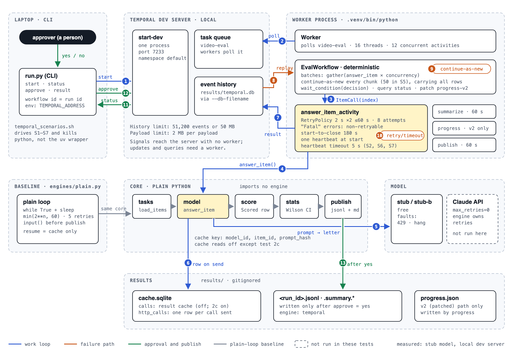

# Architecture

One model-evaluation harness, two engines on the same Python core. Each model call is one Temporal activity. Seven failure scenarios, plus a rerun of the crash with the result cache on, were measured with a free stub model on the local dev server; the numbers are in [COMPARISON.md](../COMPARISON.md).

Source: [architecture.svg](architecture.svg). Blue is the work loop, orange the failure paths, green approval and publish, grey the plain-loop baseline. A dashed box was not run in these tests.

## Step by step

1. `run start` asks the server to start `EvalWorkflow` with `EvalParams`. The run id is the workflow id.
2. The worker polls the `video-eval` task queue. The server never runs harness code; it hands out tasks.
3. The workflow schedules one activity per item, in batches of `concurrency`. The activity input carries the item's index, not the item.
4. The activity reloads the item by index, sends one heartbeat, and calls the core's `answer_item()`.
5. The core sends the prompt to the stub (or Claude) and gets back a letter answer.
6. The core writes one `http_calls` row when the request goes out, so a killed call still counts, as a real model would bill it.
7. The scored row returns to the workflow and is recorded in the event history as the activity result.
8. After a crash, a new worker replays the history. Finished activities return their recorded results; only the call in flight runs again.
9. Every `chunk` items (50 in scenario 5) the workflow continues as new: a fresh run with the same workflow id, carrying all rows so far.
10. A failed attempt retries under the retry policy. An attempt silent past the heartbeat timeout is timed out and retried.
11. `run status` queries the workflow for progress and the summary. A query needs a worker; the run itself does not.
12. A person sends `approve yes` or `no` as an update, `decide`. Its validator refuses a decision while the run is still scoring, a second decision, or any other value, and the sender sees why. With no worker polling, an update would wait forever, so the CLI stops after `--timeout` (30 s by default) and says so. `approve --signal` sends the old unchecked signal instead, which the server stores even with no worker running. A signal is never checked: one sent while the run is scoring is accepted, and it is lost if the run continues as new before the wait, because the decision is not carried over. The workflow has waited on `wait_condition` until then.
13. On yes, `publish_activity` writes the jsonl and the two summaries. On no, nothing is written.

## What failed, on purpose, and what it cost

| # | Failure | Mechanism | Setting in code | Result | Basis |
|---|---|---|---|---|---|
| 1 | Rate limit (simulated 429) | Retry policy on the activity | `2 s ×2, max 60 s, 8 attempts; "Fatal" non-retryable` | 10 calls for 10 items | measured |
| 2 | Worker `kill -9` mid-run, 30 items | History replay; the in-flight call retries after the heartbeat timeout | `--heartbeat-s 5` | 31 calls for 30 items; plain loop: 36 | measured |
| 2c | The same kill on a plain loop with the result cache on | The core cache, keyed per item | `VEU_CACHE=on` | 31 calls for 30 items, as on Temporal; a hung call still hangs | measured |
| 3 | A person must approve; worker killed while waiting | Update with a validator, then `wait_condition`; query for status; signal kept as a fallback | `decide` update, `approve` signal, `status` query | Early approval refused ("still scoring: 1 of 10 items"); RUNNING with no worker; 10 calls for 10 items; published | measured |
| 4 | New workflow code deployed mid-run | `workflow.patched("progress-v2")`; replay test in pytest | `VEU_WORKFLOW_VERSION` v1 / v2-unpatched / v2 | unpatched: both runs held, none lost; patched: old runs 0 markers, new run 1 marker | measured |
| 5 | Long run, 200 items | Continue-as-new every 50 items | `--chunk 50` | 4 runs, 305 to 322 events each; 37.7 KB carried at the last hop | measured |
| 5b | Carried rows reach the 2 MB payload limit | none: carry a pointer instead | about 12.5 KB per 50 items | near 8,000 items | computed |
| 6 | Fan-out, then a kill mid-batch | `asyncio.gather` inside one workflow | `--concurrency 8` | 2.5 s against 29.4 s; killed: 38 calls for 30 items | measured |
| 7 | A model call hangs | Heartbeat timeout, then retry | one heartbeat at start; `--heartbeat-s 5` | 5.6 s; 11 calls for 10 items; plain loop hangs (3 calls after 20 s) | measured |

In COMPARISON.md, the plain-loop column for scenarios 3 to 6 describes behaviour; it was not timed.

## Key design decisions

- **The activity input carries an index, not the item.** `ItemCall` carries the item's index and run settings, and the activity reloads the item. Video frames never enter history.
- **The engine owns retries.** The Anthropic client runs with `max_retries=0`. Errors map to Retryable or Fatal, and Fatal never retries.
- **The core never imports an engine.** The plain loop and Temporal call the same functions, so the comparison is fair.
- **Calls are logged when they are sent.** A killed call still counts, the way a real model bills it.
- **The cache was off for every measurement except scenario 2c.** With `VEU_CACHE=off`, the numbers show the engine, not the cache. Scenario 2c turns it on to test the hand-built alternative.
- **The thread pool is larger than the activity slots.** 16 threads for 12 activities, because a hung thread stays blocked until the worker exits.
- **One heartbeat, at the start.** The heartbeat timeout bounds any silent attempt, healthy or hung. For calls longer than the timeout, heartbeat from a background thread.
- **A patch plus a replay test.** The unpatched v2 code must fail replay against a saved v1 history in pytest, with no server.

## Production path

| Change | Why |
|---|---|
| Worker Versioning: pin each workflow to its deployment version | Temporal's docs prefer it over patching where versioned deployments are possible. Keep patching and replay tests for auto-upgrade workflows. |
| Carry a pointer, not the rows, through continue-as-new | The carried rows grow with every hop toward the 2 MB payload limit. |
| Keep the result cache on | Keyed on `(model_id, item_id, prompt_hash)`, it saves a call that returned but whose activity result was never recorded, and every re-run after a scoring change. It cannot save a call killed in flight. |
| Heartbeat from a background thread; add a schedule-to-close timeout | A real call can outlast one heartbeat timeout. With the default 90 s heartbeat timeout, the worst case per item is about 15 minutes (8 × 90 s plus backoff); with a heartbeat timeout of 180 s or more, about 27 minutes. |
| Observability: OpenTelemetry tracing and SDK metrics | The harness has none yet. |
| A durable server: a Temporal Cloud namespace or a self-hosted cluster | The dev server is one process on SQLite. Cloud auth is an API key (the client already supports it) or mTLS, chosen per namespace. Self-hosted means frontend, history, matching and worker services on a database. |
| A payload codec and a Codec Server, if prompts or answers are sensitive | Low priority here, because frames never enter history. |
| Child workflows to partition very large runs | Activities in one workflow are the default. Child workflows split big loads; Temporal recommends at most 1,000 per parent. |

## What this does not prove

- It ran on the local dev server, one process on SQLite. Nothing ran on Temporal Cloud.
- It survives a worker dying, not the server dying. The dev server keeps history only because of `--db-filename`.
- The model was a stub. Stub calls cost nothing; only the call counts matter.
- The call in flight at a crash is paid again: one call alone, or the whole batch with fan-out.
- Continue-as-new "suggested" was never triggered; the 50-item chunk always fired first.
- The cache comparison (2c) ran at concurrency 1, with the restart done by hand. It does not test a supervisor or a queue.

Sources: the code in this repo; runs of 2026-10-22 (scenario 3 on 2026-10-28 and 2026-10-29; scenario 2c on 2026-10-29) with the stub model and the cache off (on in scenario 2c), from `scripts/temporal_scenarios.sh`; limits and versioning guidance from [docs.temporal.io](https://docs.temporal.io).
